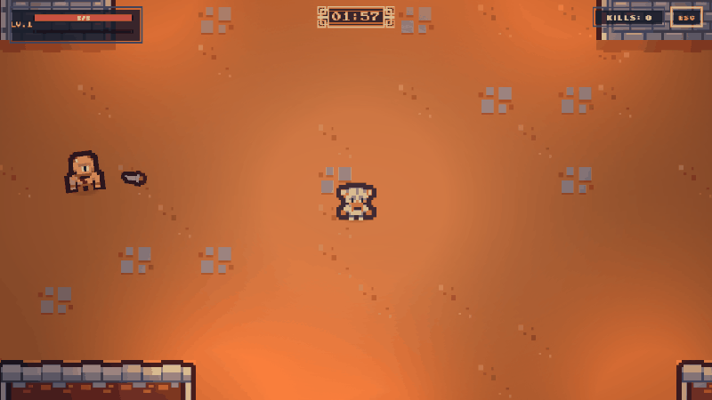
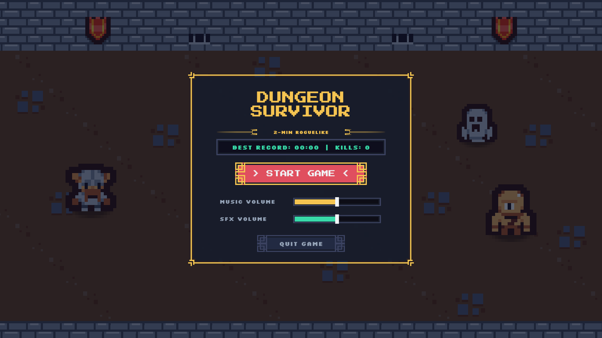
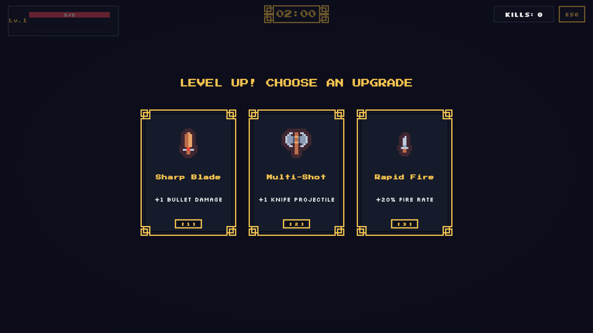
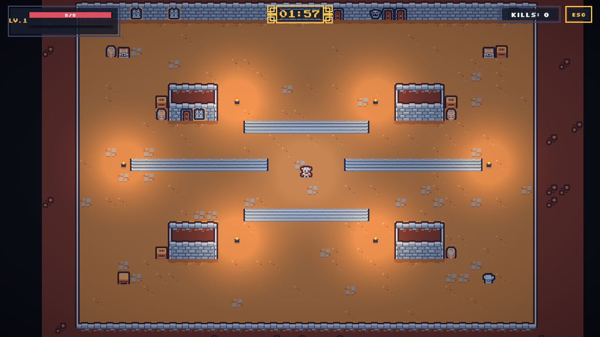
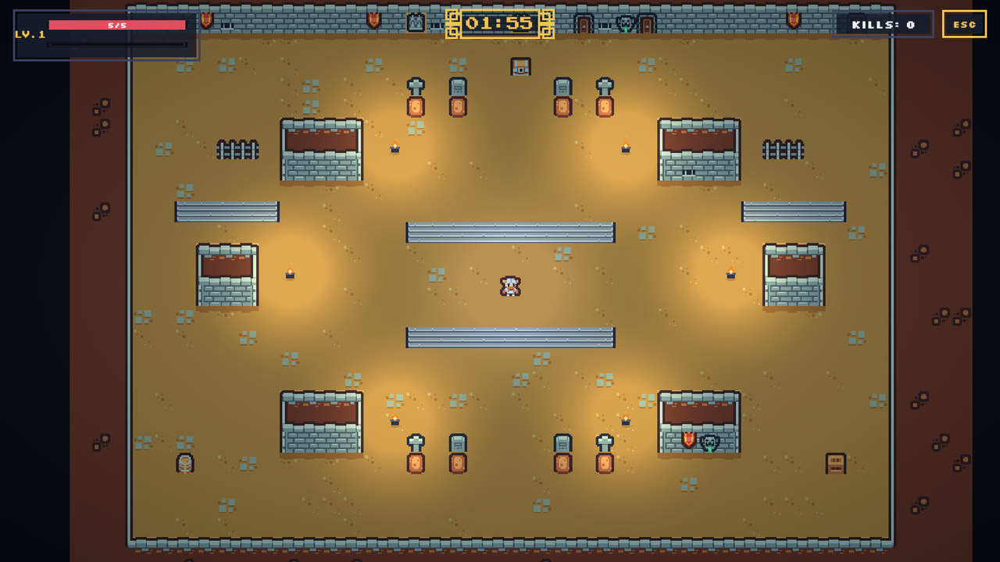
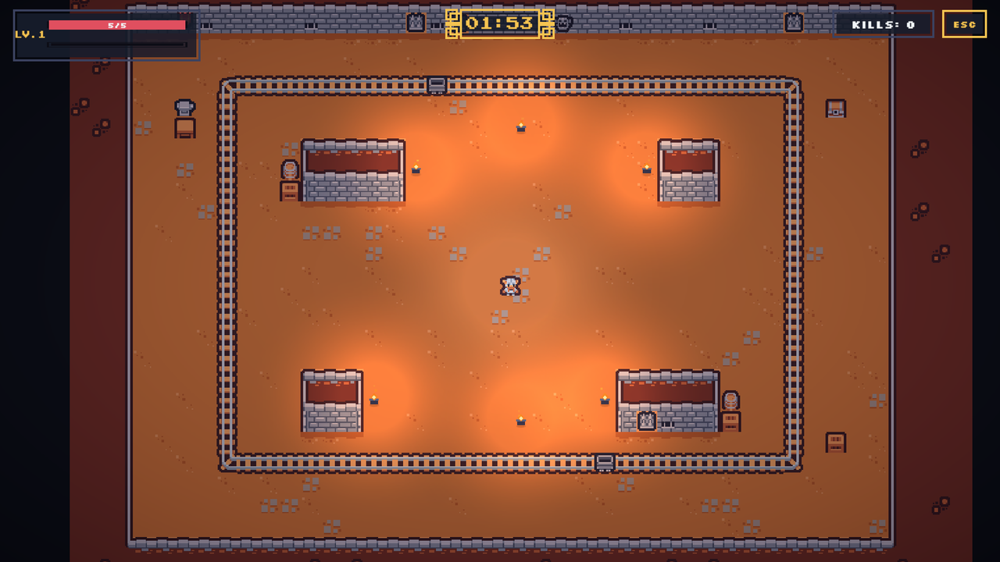
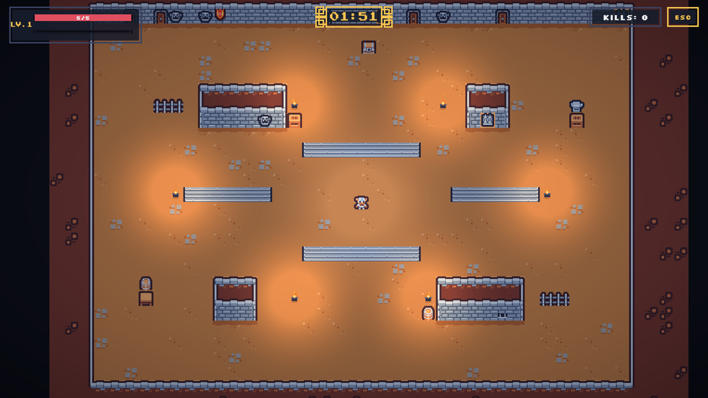
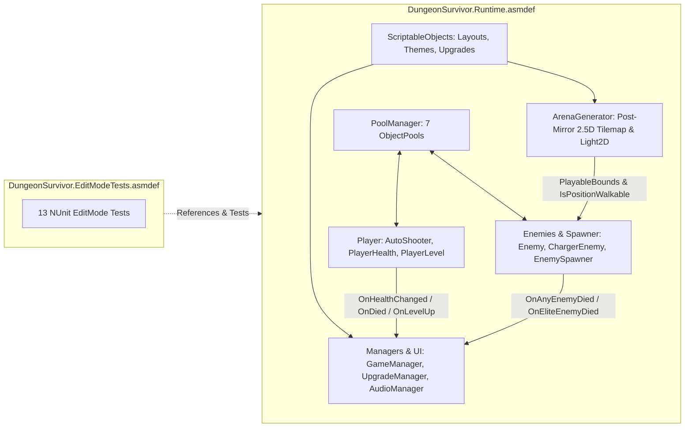

# Dungeon Survivor

A 2D top-down roguelike survival game made with **Unity 6 (`6000.6.7f1`)** and **URP 2D**. You have two minutes to survive scaling enemy waves, weave around dungeon pillars, pick upgrades cleanly from level-ups, and beat your previous time and kill records.



| Main Menu | Level-Up Upgrades (`1` / `2` / `3`) |
| :---: | :---: |
|  |  |

---

## Gameplay & Controls

- **Move (`WASD` / `Arrow Keys`):** Move your knight around the hall while `AutoShooter` automatically fires at the closest enemy in line of sight.
- **Level Up (`1` / `2` / `3` or Click):** Collect XP gems to level up, pick one of three randomized upgrades (`FireRate`, `BulletDamage`, `MoveSpeed`, `MaxHealth`, `MagnetRadius`, or `MultiShot`), and queue multiple picks cleanly if a burst of XP skips levels.
- **Pause (`ESC`):** Open the pause screen with persistent Music & SFX volume sliders (blocked cleanly while the Level-Up or End screen is open).

---

## Procedural 2.5D Arenas

Each run picks from **`4` room layouts × `3` lighting/color themes × `X`/`Y` symmetry flips (`48` combinations)** inside a **36×24** playable hall. A `7×7` center zone (`[-3..3, -3..3]`) is always kept clear around player spawn so enemies or props never trap you at `t = 0`.

Early on, simply mirroring raw tiles caused bottom brick faces to flip upside-down whenever `signY == -1`. To fix that, `ArenaGenerator` writes all solid cells into an in-memory grid *after* mirroring, then resolves wall parapet rims, south-facing brick walls (banners, doors, grates, gargoyles), floor drop shadows, grave dirt mounds, and minecart rail curves in world-down order.

| Grand Sanctum (`Crypt Stone`) | Cursed Catacombs (`Mossy Catacombs`) |
| :---: | :---: |
|  |  |
| **Abandoned Mine (`Ember Vault`)** | **Prison Courtyard (`Crypt Stone`)** |
|  |  |

---

## Technical Notes

I built this project to practice writing clean, testable Unity C# without allocating garbage every frame or tangling scene references together.



### A few implementation details I focused on
- **Object Pooling (`PoolManager.cs`):** Bullets, all three enemy types (`Normal`, `Charger`, `Elite`), XP gems, death particles, and floating damage numbers all run through `UnityEngine.Pool.ObjectPool<T>` (`collectionCheck: true`). `Bullet` (`isReleased`) and `XPGem` (`isCollected`) guard against same-frame double-trigger bugs, and `ChargerEnemy.Initialize` resets dash timers, velocity, tint, and its telegraph indicator when pulled from the pool.
- **Non-Alloc Targeting & AI Steering:** `AutoShooter` scans with `Physics2D.OverlapCircle` into a fixed `Collider2D[32]` buffer, compares `sqrMagnitude` before calling `Physics2D.Linecast`, and holds fire if the nearest enemy is behind a wall. Enemies cast a short forward ray plus four angled whisker rays (`±45°`, `±80°`) in `Enemy.GetSteeredDirection` to slide around pillars cleanly instead of piling into corners.
- **UI & Audio Continuity:** Gameplay components communicate with `GameManager` and `UpgradeManager` via C# `event Action` delegates rather than direct references. `UpgradeSO.CanApply` filters out `FireRate` (`<= 0.15s`) and `MultiShot` (`>= 7`) once maxed. `AudioManager` persists across scenes and resumes BGM on the first button click so WebGL browser autoplay rules do not mute music.
- **Assembly Separation & Automated Tests:** Gameplay scripts live in `DungeonSurvivor.Runtime.asmdef` and NUnit tests stay isolated in `DungeonSurvivor.EditModeTests.asmdef` (`Editor` only), keeping `nunit.framework.dll` out of player builds. All **13 EditMode tests** check XP rollover (`while` loop), duplicate/cap filtering on upgrades, layout safe-zone/bounds constraints across all `.asset` files, double-release pool safety, and Pause/`ESC` state rules.

---

## Build & Verification Summary

- **EditMode Tests:** `13 / 13` Passed (`PlayerLevelTests`, `UpgradeSelectionTests`, `ArenaLayoutValidationTests`, `CombatPoolingTests`)
- **Windows x64 Build (`Builds/Windows/DungeonSurvivor.exe`):** `110.97 MB`, `0` errors (`DungeonSurvivor.Runtime.dll` packaged, zero test DLLs included)
- **WebGL Build (`Builds/WebGL/`):** `22.78 MB`, `960×540` canvas, `Gzip` + Decompression Fallback, `stripEngineCode` enabled, `#if UNITY_WEBGL` guard hides the Quit button

---

## Running Locally

### Unity Editor
1. Open the `DungeonSurvivor/` folder in **Unity `6000.6.7f1`**.
2. Open `Assets/Scenes/MainMenu.unity` and press **Play**, or run all unit tests via **Window > General > Test Runner > EditMode > Run All**.

### WebGL Build in Browser
Browsers block `file://` loading for `.wasm` and `.data` bundles, so serve `Builds/WebGL` over HTTP:

```bash
cd Builds/WebGL
python -m http.server 8000
```

Open `http://localhost:8000` and click **PLAY GAME**.

---

## Project Layout

```text
DungeonSurvivor/
├── Assets/
│   ├── Arenas/            # 4 ArenaLayoutSO, 3 ArenaThemeSO, 49 Tile assets
│   ├── Art/               # Tiny Dungeon spritesheets & pixel UI elements
│   ├── Audio/             # Background track & OGG/WAV SFX
│   ├── Fonts/             # Press Start 2P & Silkscreen TMP fonts
│   ├── Prefabs/           # Player, Enemies, Bullet, XPGem, Torch, VFX, AudioManager, SceneFader
│   ├── Scenes/            # MainMenu.unity & Gameplay.unity
│   ├── Scripts/           # Runtime code (DungeonSurvivor.Runtime.asmdef)
│   ├── Tests/EditMode/    # 13 NUnit tests (DungeonSurvivor.EditModeTests.asmdef)
│   └── Upgrades/          # 6 ScriptableObject upgrade cards
├── Builds/                # Gitignored Windows x64 & WebGL outputs
└── media/                 # Gameplay GIF & README screenshots
```

---

## Credits

- **Dungeon Art & Sprites:** *Tiny Dungeon* by [Kenney](https://kenney.nl/assets/tiny-dungeon) (CC0 1.0)
- **Pixel Fonts:** *Press Start 2P* & *Silkscreen* (OFL)
- **Music & SFX:** Royalty-free / CC0 chiptune audio and retro SFX
